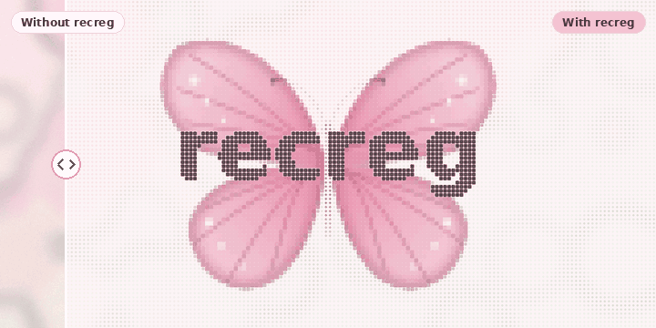

<p align="center">
  
</p>

<h1 align="center">recreg</h1>

<p align="center"><strong>Your feed. Your rules.</strong></p>

<p align="center">
  A browser extension that lets you decide what gets recommended to you on YouTube, Reddit and Pinterest.<br>
  Local, private, no account.
</p>

<p align="center">
  
</p>

<p align="center">
  <a href="#install">Install</a> ·
  <a href="#how-it-works">How it works</a> ·
  <a href="#evidence">Evidence</a> ·
  <a href="#privacy">Privacy</a>
</p>

> Interacting with content is not consent to future recommendations.

---

## What it does

You write down what you don't want to see: a topic preset (gambling, alcohol,
shopping prompts, distressing news, common phobias) or your own words and
phrases. As recommendations load, recreg checks every card against your rules
and covers the matches before they render. One click reveals any item, and a
"Why?" button tells you which of your words matched.

- Works on **YouTube**, **Reddit** and **Pinterest** (home feed, Up next, Shorts shelf, subreddit feeds, pin grid).
- Only recommendation areas are filtered. Your own searches pass through untouched.
- Optional on YouTube: a **Not interested on YouTube** button on each covered card, or an
  **auto** mode that reports every filtered video to YouTube as you scroll so its own
  Undo notice replaces the recreg cover. Both are off by default and use your signed-in account.

## Install

recreg is not on the Chrome Web Store yet. Loading it takes about a minute on
Chrome, Edge, Brave or Arc.

1. Download the extension zip from the landing page, or build it yourself:
   ```sh
   npm install
   npm run build:ext        # output: extension/dist/
   ```
2. Open `chrome://extensions` and turn on **Developer mode**.
3. Click **Load unpacked** and pick the unzipped folder (or `extension/dist/`).
4. Open recreg's settings (toolbar icon → **Open settings**), enable the sites
   you want (the browser asks permission one site at a time), then add words or
   apply a preset.
5. Reload any tabs that were already open.

The toolbar badge shows how many items are hidden on the current page. The
popup gives you pause, quick-add, per-page status and the YouTube auto toggle.

## How it works

```
your words / presets  ──▶  chrome.storage.local  (never leaves the device)
                                   │
                                   ▼
page loads ──▶ content script finds recommendation cards (site adapter selectors)
                                   │  reads title / channel / aria-label text
                                   ▼
                         matching engine (pure function)
                   whole-word · phrase · substring · Unicode-aware
                                   │
                     match ────────┼──────── no match
                       ▼                        ▼
            cover (Show · Why?)            shown as normal
            or remove entirely
```

1. Content scripts are registered per site, only after you grant that site.
2. A `MutationObserver` keeps up with infinite scroll and in-page navigation.
3. Cards stay invisible until they have been checked, so nothing flashes before filtering.
4. Your terms are always treated as literal text, never as regular expressions.
5. If a site redesign breaks an adapter, the popup and badge show a visible
   **degraded** state instead of quietly showing an unfiltered feed.

The landing page demo runs the exact same engine the extension ships.
Full design and threat model: [ARCHITECTURE.md](ARCHITECTURE.md).

## Evidence

We measured the presets on 200 video titles we wrote and labelled ourselves
(100 for tuning, 100 held out), using the same matching code the extension
ships. The numbers below are from the **tuning set**, after adjusting the
preset words on it, so treat them as optimistic.

| Preset | Caught | Hidden by mistake |
|---|---|---|
| Gambling | 11 / 12 | 3 / 88 |
| Alcohol | 12 / 12 | 1 / 88 |
| Shopping prompts | 8 / 12 | 4 / 88 |
| Distressing news | 11 / 12 | 1 / 88 |
| Common phobias | 9 / 12 | 4 / 88 |
| **All** | **51 / 60 (85%)** | **13 / 440 (3%)** |

What it gets wrong, on purpose shown: *Spider-Man: No Way Home* is covered
(matches "spider"), *Casino Royale film review* is covered, `HUGE sp1der found
in garage` slips through, and titles with no keyword at all are missed.

Limitations of this measurement: titles only (no thumbnails or descriptions),
all in English and written by us, small samples (one title moves a preset by
about 8 points), human labels. The evaluation kit and raw results are in
[`recreg-eval/`](recreg-eval/); `node recreg-eval/measure.mjs --split dev`
reproduces the table.

## Privacy

Private by architecture, not by promise.

- **No servers, no accounts, no telemetry.** Your filter list lives in
  `chrome.storage.local` on your device. There is nothing to leak *to*.
- **Zero network access.** The extension requests no network capability at
  all; the manifest asks only for `storage` and `scripting`. A CI gate fails
  the build if `fetch`, `XMLHttpRequest`, `innerHTML` or `eval` appear in `src/`.
- **Least privilege.** Site access is granted per site, by you, only for the
  sites you enable. No `<all_urls>`, no `tabs`, no `webRequest`.
- **Your filters are not displayed on the page.** Covers never name the matched
  word unless you press "Why?".
- **YouTube feedback is opt-in.** The only thing that ever reaches a platform is
  YouTube's own "Not interested", sent through its own menu, and only if you
  turned that on. recreg never fills in or submits "Tell us why".

## Development

```sh
npm install
npm run verify          # security gate → typecheck → tests → build
npm run dev             # build the site and serve it at http://localhost:4173
```

| Script | What it does |
|---|---|
| `npm run verify` | security check → typecheck → tests → full build |
| `npm run build:ext` | extension → `extension/dist/` |
| `npm run build:frontend` | landing site + extension zip → `frontend/dist/` (what Vercel deploys) |
| `npm test` | engine, preference-validation and adapter unit tests |
| `npm run check:security` | fail if network calls, HTML sinks or dynamic code appear in `src/` |

```
src/engine/       pure matching engine, presets, preference schema (no DOM, no I/O)
src/adapters/     per-site selector definitions — data, not code
src/extension/    MV3 extension: service worker, content script, popup, options
src/site/         landing-page scripts (reuse the engine)
frontend/         landing page HTML/CSS/assets (Vercel root is frontend/dist)
recreg-eval/      preset evaluation kit and labelled titles
tests/            unit tests
scripts/          security gate, static dev server
build.mjs         esbuild bundling, icon generation, extension zip
```

## Known limitations

- **Selector drift:** YouTube, Reddit and Pinterest change their DOM regularly.
  Adapters in `src/adapters/index.ts` carry fallbacks but need periodic
  checking against the live sites.
- **Word matching is literal:** a rule for `bet` does not match `bets`. Presets
  include common inflections; add your own as needed.
- **Text only:** image-only content with no text or alt labels can't be matched.
- **Instagram** is not supported: its obfuscated, fast-changing DOM makes a
  reliable adapter a project of its own.

## Roadmap

- Signed remote adapter updates, so site redesigns don't wait on store review.
  This would be the only network feature the extension ever gains.
- Firefox build (same WebExtensions codebase, minor manifest differences).
- On-device semantic matching on top of keyword rules.
- More sites: X/Twitter, TikTok web, news aggregators.
